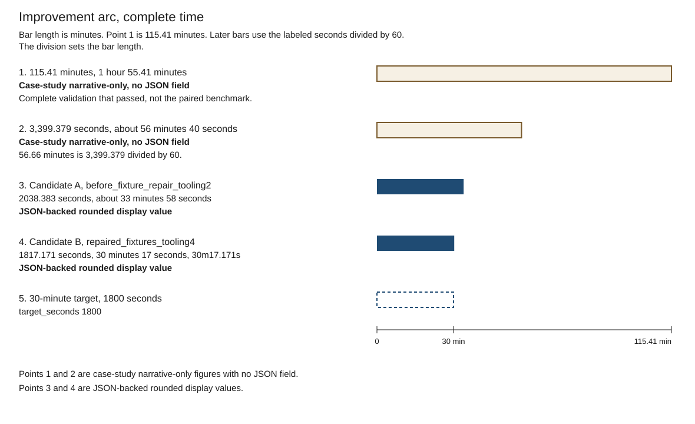

# test-efficiently

A portable skill for writing useful tests and speeding up existing suites
without weakening behavior, coverage or evidence. Start with [SKILL.md](SKILL.md):
it routes small test edits directly to a short design path and sends risky
boundaries or performance work to the relevant controls.

## Install or use directly

Copy this folder as `test-efficiently`, including `SKILL.md`, `references/`,
`data/` and `LICENSE`, into the skills location documented for one project or
for your user account. If that folder already exists, review it before
replacing it.

You can also pass [SKILL.md](SKILL.md) along with the files it links to. No
extra integration, scripts or service connection is required.

## What the measurements show

The chart leads with the controlled comparisons. Same content, measured before
and after.

The matrix subset, three pairs and six runs, has a baseline median of 104.244
seconds and a candidate median of 50.687 seconds. The median paired reduction
is 51.47%.

CLI reads, seven pairs, improved in every pair. The median paired reduction is
25.4%. Absolute seconds were not released, so that result is a percentage only.

The tooling stage is two separate single observations, not a paired
measurement: 486.782 seconds with two fragments, and 257.152 seconds with four
fragments.

The lower panel lists complete-suite times. Those points are separate
observations with different content and configuration, not a controlled
before/after.

115.41 minutes is a narrative-only complete validation, with no structured
field, and it was not the paired benchmark. 3,399.379 seconds (56.66 minutes)
is narrative-only and had no same-content control. Candidate A took 2038.383
seconds (approximately 33m58s) and failed two source cases. Candidate B took
1817.171 seconds (30m17.171s), passed, and is still above the 1800-second
target.

Figures are the rounded display values in the [case study](references/case-study.md)
and the [measurements](data/benchmark-runs.json). The originating codebase is
unpublished. Each full configuration is one sample. Estimates stay separate
from observations.

This skill and the supplied anonymous data are available under [MIT](LICENSE).
