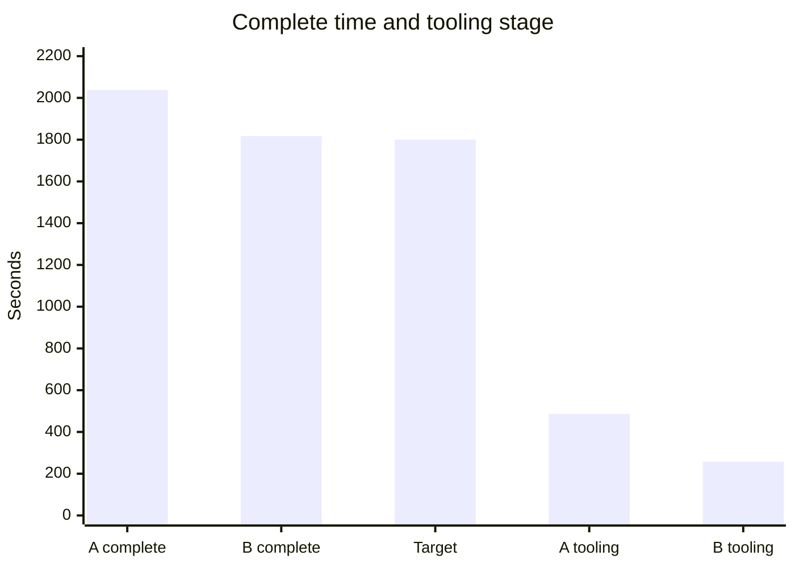

# test-efficiently

A portable skill for writing useful tests and speeding up existing suites
without weakening behavior, coverage or evidence. Start with [SKILL.md](SKILL.md):
it routes small test edits directly to a short design path and sends risky
boundaries or performance work to the relevant controls.

## Install or use directly

Copy this folder as `test-efficiently`, including `SKILL.md`, `references/`,
`data/` and `LICENSE`, into one chosen destination. Include the optional
`agents/` folder to retain Codex UI metadata:

| Assistant | This project | All projects for this user |
|---|---|---|
| Codex | `<project>/.agents/skills/test-efficiently/` | `~/.agents/skills/test-efficiently/` |
| Claude Code | `<project>/.claude/skills/test-efficiently/` | `~/.claude/skills/test-efficiently/` |

Use a project destination for team-local instructions or the user destination
for personal reuse. If that folder already exists, review it before replacing
it. In Codex, invoke `$test-efficiently`; in Claude Code, invoke
`/test-efficiently`. Both also select relevant skills automatically.
See the official [Codex skill documentation](https://learn.chatgpt.com/docs/build-skills)
and [Claude Code skill documentation](https://code.claude.com/docs/en/skills)
for discovery and scope details.

The supplied `agents/openai.yaml` is optional Codex UI metadata: its display
name, short description and starter prompt help present and invoke the skill.
It is not an agent implementation or a requirement for other assistants.
You can also give an assistant [SKILL.md](SKILL.md) directly and make the linked
files available; no harness integration, scripts or service connection is required.

## Evidence and license

### Case study numbers

The chart uses rounded display values from the [anonymous case study](references/case-study.md) and [data/benchmark-runs.json](data/benchmark-runs.json).

Candidate A is `before_fixture_repair_tooling2`. Candidate B is `repaired_fixtures_tooling4`.

Both record `target_met` as false against `target_seconds` 1800. Complete time is `elapsed_seconds.conservative_complete`. Tooling time is `stages_seconds.tooling`.

Candidate A records `functional_pass` as false. Candidate B records `functional_pass` as true. The runs are separate observations.

The second chart is the improvement arc for complete time.

Bar length is minutes. The first bar is 115.41 minutes. Each later bar uses
that point's stated seconds divided by 60. The division sets the bar length.

Point 1 is the complete 115.41-minute validation that passed. The case study
says the full run was not the paired benchmark. 115.41 minutes is 1 hour
55.41 minutes. Point 1 is a case-study narrative-only figure with no JSON
field.

Point 2 is 3,399.379 seconds, about 56 minutes 40 seconds. The case study
says the 56.66-minute figure is narrative-only and text-report-only. The
56.66-minute figure is 3,399.379 divided by 60. Point 2 has no JSON field.

Point 3 is Candidate A, `before_fixture_repair_tooling2`. Complete time is
about 33 minutes 58 seconds. The rounded display value from JSON
`elapsed_seconds.conservative_complete` is 2038.383, the same value as the
chart above. The case study table says approximately 33m58s. Exact clocks
are in JSON.

Point 4 is Candidate B, `repaired_fixtures_tooling4`. Complete time is 30
minutes 17 seconds, 30m17.171s. The rounded display value from JSON
`elapsed_seconds.conservative_complete` is 1817.171, the same value as the
chart above.

Point 5 marks the 30-minute target, `target_seconds` 1800.

Points 1 and 2 are case-study narrative-only figures with no JSON field.
Points 3 and 4 are JSON-backed rounded display values.

The [anonymous case study](references/case-study.md) and
[sanitized measurements](data/benchmark-runs.json) are self-contained examples.
The originating codebase is unpublished. Only authorized aggregate measurements
are provided: repository, issue, revision and internal test/entry identifiers
are omitted. Raw traces, source code and private records are not included.
Estimates are separate from observations, including a failed run and a green
full run that still exceeded its target. Each full configuration has one sample.

This skill and the supplied anonymous data are available under [MIT](LICENSE).
